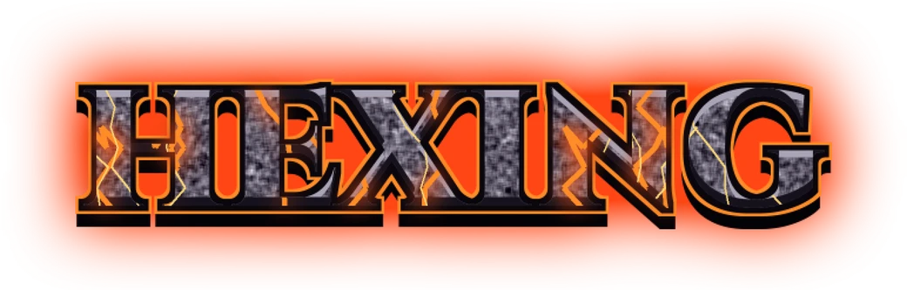
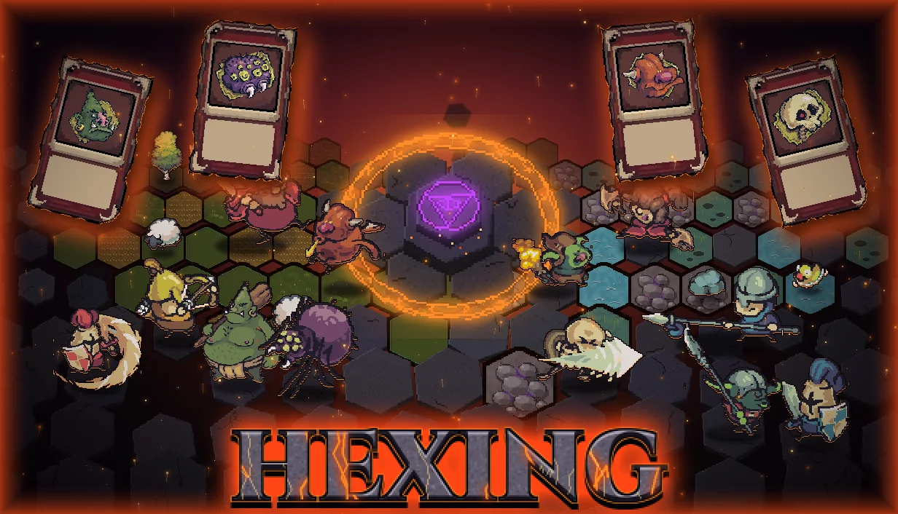
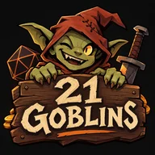

  

<b>Build a living dungeon one hex at a time.</b>

  <a href="https://store.steampowered.com/app/4998470/Hexing/">Wishlist on Steam</a> ·
  <a href="https://discord.gg/SJA3zb4m3p">Discord</a> ·
  <a href="https://21goblingames.github.io/">Website</a>

**Hexing** is a roguelite tower defense deckbuilder where you don't command your monsters: you build the dungeon that fights for you. Draft cards, place monster camps on a hex map, surround them with shrines, traps and runes, and grow a handful of goblins into an army that holds back endless waves of heroes marching on your summoning circle.

- ⬢ **Place camps.** Every camp spawns monsters that fight heroes on their own.
- ⬢ **Earn gold, buy cards.** Slain heroes drop gold to spend in the shop.
- ⬢ **Survive the waves.** Each wave is bigger and stronger than the last.
- ⬢ **Sign pacts.** Damage milestones offer demonic pacts that bend the rules, each with a price.
- ⬢ **Short, replayable runs** of about 5 to 15 minutes.

## About this repo

This is the source of [21goblingames.github.io](https://21goblingames.github.io/), the home page for Hexing and the 21 Goblins studio. It's one hand-written HTML page and a stylesheet, no build step and no JavaScript. Pushing to `main` publishes it through GitHub Pages within a minute or two.

| File | What it is |
| --- | --- |
| `index.html` | The page, plus its social preview tags and game metadata |
| `style.css` | All styling |
| `404.html` | Lost-goblin page for bad links |
| `img/` | Store art, logos and icons (WebP for the page, JPG for social previews) |

The [privacy policy](https://21goblingames.github.io/hexing-privacy/) lives in its own repo, [hexing-privacy](https://github.com/21goblingames/hexing-privacy).

## Contact

Press and business: [21goblingames@gmail.com](mailto:21goblingames@gmail.com)

 Made by 21 Goblins, a solo indie studio.

